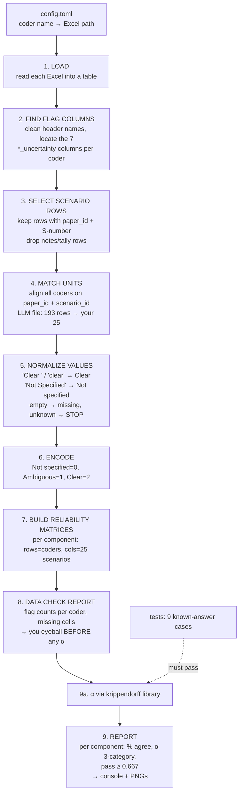

## Krippendorff's Alpha: Reliability of Threat-Model Component Coding

Human coders  or llms independently flag a random sample of scenarios using the same codebook. The scripts here measure agreement between **CODERS**:, `human (mentee) vs human (mentee)`,`human vs LLM`, `LLM vs LLM`with **Krippendorff's alpha (α)**, the standard chance-corrected reliability coefficient in content analysis.

The seven components: _threat source, objective or harmful outcome, capability, knowledge, access, constraints or enabling conditions, target or asset at risk._

## What Krippendorff's alpha measures

Two individuals can agree simply by chance, especially when one flag dominates. Alpha removes that chance agreement:

$$
\alpha = 1 - \frac{D_o}{D_e}
$$

- **Dₒ (observed disagreement):** how often coders actually gave different flags to the same scenario.
- **Dₑ (expected disagreement):** how often two flags drawn at random from *all* flags given (pooled across coders, without replacement) would differ.

| α             | Meaning                                     |
| -------------- | ------------------------------------------- |
| 1              | perfect agreement                           |
| 0              | no better than chance                       |
| < 0            | systematic disagreement (worse than chance) |
| ≥ 0.800       | reliable                                    |
| 0.667 – 0.800 | acceptable for tentative conclusions only   |
| < 0.667        | do not rely on the data                     |

**Project layout:**

```
krippendorff-alpha/
├── config.toml              # coders: name, kind (human / llm), Excel file, sheet
├── data_preprocessing.py    # shared: load, clean, match, encode, matrices, --human/--llm/no flag
├── k_alpha_script.py         # alpha via the krippendorff package
├── helper_visual_lp_graph.py           # lollipop chart (one card per comparison, 2 per row)
├── helper_visual_comparison_table.py   # comparison tables: coders' raw labels side by side
├── tests/                   # published + hand-computed test cases
├── materials/               # coding sheets (not for public release)
└── results/                 # generated PNG files
```

## Setup and run (uv)

```Shell
uv sync
uv run pytest -q                        # tests must pass
uv run python k_alpha_script.py -h       # usage guide

uv run python k_alpha_script.py --human  # only the human coders (mentees), with each other
uv run python k_alpha_script.py --llm    # only the LLM coders: all LLMs together + every LLM pair
uv run python k_alpha_script.py          # no flag: all coders (humans + LLMs) combined
```

Who counts as human or LLM is set by `kind` in `config.toml`. Each mode loads only the sheets it needs:

## Reading the output

1. **DATA CHECK.** Flag counts per coder per component. Review these first: if they are wrong, every α after them is wrong.
2. **α table.** Per component: number of scenarios, % agreement and 3-category α, and the verdict against 0.667.
   `n/a` with verdict `no variation` is **not an error**: every coder gave the same flag to every scenario
   (e.g. all Clear), so D_o = D_e = 0 and α = 0/0. Agreement is 100%, but α has nothing to measure.
3. **`results/k_alpha_chart_<human|llm|all>_<timestamp>.png`**: lollipop chart of the 3-category α per component,
   with the threshold lines and % agreement beside each row. One card per comparison (2 per row),
   all on the same α scale.
4. **`results/k_alpha_labels_<comparison>_<timestamp>.png`**: raw coding comparison images, one per comparison.

## References

- Krippendorff, K. (2011). *Computing Krippendorff's Alpha-Reliability.* Annenberg School
  for Communication. [PDF](<https://www.asc.upenn.edu/sites/default/files/2021-03/Computing%20Krippendorff%27s%20Alpha-Reliability.pdf>)
- Hayes, A. F., & Krippendorff, K. (2007). Answering the call for a standard reliability measure for coding data. *Communication Methods and Measures*, 1(1), 77–89. [www.afhayes.com/public/kalpha.pdf](https://www.afhayes.com/public/kalpha.pdf)
- Krippendorff, K. (2004/2013). *Content Analysis: An Introduction to Its Methodology.* Sage.
- Feinstein, A. R., & Cicchetti, D. V. (1990). High agreement but low kappa: I. The
  problems of two paradoxes. *Journal of Clinical Epidemiology*, 43(6), 543–549.
- [fast-krippendorff](https://github.com/pln-fing-udelar/fast-krippendorff), the `krippendorff` Python packag

### Why we are using Krippendorff's alpha

```
                  scenarios
                      │
          ┌───────────┴───────────┐
          ↓                       ↓
       coder 1                 coder 2
          │                       │
          └───────────┬───────────┘
                      ↓
             Compare classifications
                      │
             ┌────────┴────────┐
             │                 │
          Agree             Disagree
             │                 │
             ↓                 ↓
       Keep agreement      Discuss/review
                               │
                               ↓
                         Consensus decision
                               │
                               ↓
                          GOLD STANDARD

Then:

              LLM
               │
               ↓
       Same scenarios
               │
               ↓
       Same 7 components
               │
               ↓
 Clear / Ambiguous / Not specified
               │
               ↓
       Compare against
       human consensus
       assumed gold standard
```

## FULL PIPELINE (STEPS)



### Each step in plain words

1. **Load.** Read each Excel file into a table (pandas). Nothing is changed yet.
2. **Find the flag columns.** Your header names are messy: `'objective_or_harmful_outcome_uncertainty\n'` has a hidden line break, and `'access_uncertaintyt'` has a typo. The script cleans the names (removes spaces and line breaks, lowercases them). Then, for each component, it finds **exactly one** column that starts with the component's name and contains "uncert". Evidence columns are ignored. If a column is missing or two match, it **stops** and says which.
3. **Select scenario rows.** Keep only rows with a `paper_id` and a scenario ID like `S4`. Your sheet has **4 notes rows at the bottom** (`total_ambiguous: 16`, `total_clear …`, and so on). They get skipped and listed in the data check.
4. **Match units.** A "unit" is one scenario, identified by `paper_id` + `scenario_id`. Your 25 keys define the set. From the LLM file (193 rows) it takes just those 25. If any coder is missing a key, or has it twice, it **stops**. (I checked: all 25 of your keys exist in the library exactly once.)
5. **Normalize values.** Fix the spelling variants. Your sheet has 8 different spellings:
6. **Encode.** Turn words into numbers, because α works on numbers: Not specified = 0, Ambiguous = 1, Clear = 2.
7. **Build reliability matrices.** For each of the 7 components, one small table: one row per coder, one column per scenario, as in the guide's Step ①.

   ```
   access            unit1 unit2 unit3 ... unit25
   human                2     0     1   ...   2
   llm                  0     1     1   ...  NaN   ← NaN = missing
   ```
